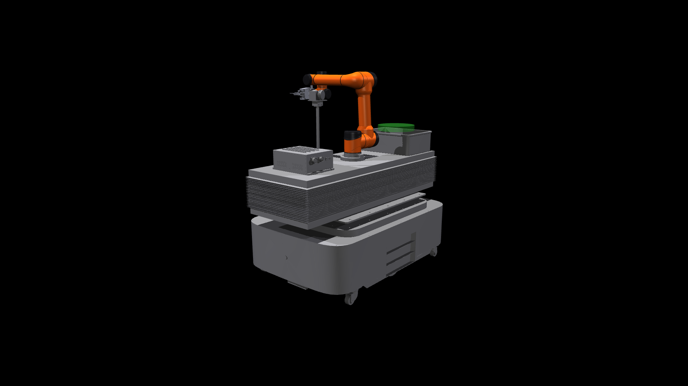

# 番茄采摘机器人整车 MuJoCo 模型 (Tomato Harvest Robot – MuJoCo Model)

番茄采摘机器人原型的**自包含整车模型**（MuJoCo MJCF 格式），clone 即用，无任何外部路径依赖：

AGV 底盘（4 大轮 + 4 小轮 + 2 驱动轮）＋ 电动升降台 ＋ AUBO i5 六轴机械臂 ＋ 齿轮平行夹爪 ＋ 车载相机（2× RealSense L515 场景相机、1× D405 腕部相机）＋ 收集筐碰撞体。



## 快速开始

```bash
pip install mujoco
python -m mujoco.viewer --mjcf=tomato_picker_standalone.xml
```

或用 Python 加载：

```python
import mujoco

model = mujoco.MjModel.from_xml_path("tomato_picker_standalone.xml")
data = mujoco.MjData(model)
mujoco.mj_resetDataKeyframe(model, data, 0)  # "home" 姿态

with mujoco.viewer.launch_passive(model, data) as v:
    while v.is_running():
        mujoco.mj_step(model, data)
        v.sync()
```

## 模型概览

| 项 | 数值 |
|---|---|
| body | 24（底盘 / 10 轮 / 升降台 / 臂 6 连杆 / 夹爪 3） |
| 关节 (qpos) | 21 = 底盘滑动 1 + 轮 10 + 升降 1 + 臂 6 + 夹爪 3 |
| actuator | 11（底盘 / 轮 / 升降 / 臂 6 / 夹爪） |
| keyframe | `home`、`lift_high`（升降抬到 0.45 m） |
| 相机 | `cam_scene_yp_l515`、`cam_scene_yn_l515`（升降台上）、`cam_wrist_d405`（腕部） |
| mesh | 360 个 STL（约 27 MB），纯颜色渲染、无贴图依赖 |

## 目录结构

```
├── tomato_picker_standalone.xml   # 整车 MJCF（meshdir="." 相对本文件）
├── preview.png
└── meshes/
    ├── cad/       # 底盘壳体、升降柱、轮组（CAD 导出，scale=0.001）
    ├── aubo/      # AUBO i5 连杆碰撞网格
    ├── arm/       # AUBO i5 连杆可视网格
    ├── gripper/   # 夹爪与工具安装座
    └── cam/       # 腕部 D405 相机壳体
```

## 使用说明

- **整车行驶**：`machine_slide` 滑动关节（±2.5 m，对应沿轨道行走），由 `machine_servo` 位置伺服驱动；车体由该关节悬挂，场景中无地面也保持姿态。轮关节为随动（视觉滚动）。
- **升降台**：`lift_joint` 行程 0–0.5 m，执行器 `lift_servo`；机械臂基座与两台场景相机、收集筐都装在升降台上。
- **机械臂**：标准 AUBO i5 运动学（`shoulder/upperArm/foreArm/wrist1/wrist2/wrist3_joint`），厂商 armature 与力矩限制已内置。
- **夹爪**：`gear_joint` 开合，两手指经 `couple_left/right` equality 与齿轮连杆耦合，`ctrlrange` 即全行程。
- 所有 body/joint/actuator 名称与作者仿真工程一致，控制代码可无缝迁移。

## 来源

剥离自作者的番茄温室采摘仿真环境（`tomato_picker` 项目），不含温室植株部分。如需引用或有疑问，欢迎提 issue。
